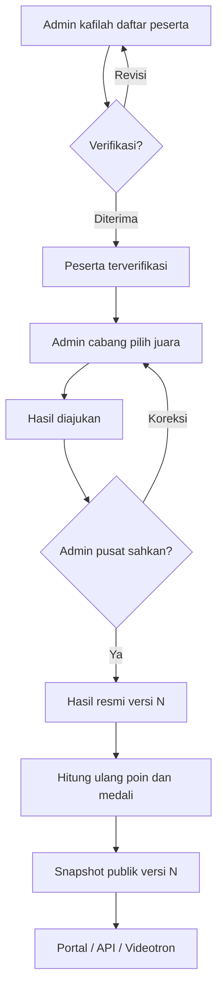

# 04 — Workflows, Status & State Machines

## A. Pendaftaran peserta
`draft -> submitted -> under_review -> verified | revision_required | rejected`.
- `draft`: pemilik kecamatan dapat edit dan menghapus sebelum submit.
- `submitted`: masuk antrean; user tidak dapat edit tanpa menarik pengajuan atau status revisi.
- `under_review`: verifikator membaca dokumen privat, hasil review dicatat.
- `revision_required`: admin kafilah dapat edit bidang yang ditolak lalu resubmit.
- `verified`: entry diizinkan untuk daftar tampil dan pemilihan juara.
- `rejected`: perlu tindakan resmi untuk dibuka kembali.
- Jangan memperbolehkan hasil juara untuk entri `draft/rejected`.

## B. Nomor lomba
`configured_draft -> registration_open -> registration_closed -> scheduled -> in_progress -> submitted_result -> official -> archived`.
- Informasi jadwal/babak bisa diubah lewat publish terpisah.
- Tidak membuat fitur penilaian internal.
- Hasil dapat disahkan walaupun sesi/jadwal tidak digunakan untuk cabang tertentu.

## C. Input hasil
`draft -> submitted -> needs_revision | approved -> superseded`.
1. Admin cabang pilih event -> cabang -> golongan -> kategori -> hasil.
2. Juara berupa `entryId`/`teamId` valid; semua distinct untuk satu nomor lomba, kecuali aturan tie disahkan dan dimodelkan eksplisit.
3. Pengguna mengunggah bukti hasil (jika diaktifkan; media privat tidak dipublish) atau mengisi nomor berita acara, tanggal penetapan, catatan.
4. Admin cabang klik Kirim untuk Pengesahan; simpan `submittedBy`, `submittedAt`, `version`, `idempotencyKey`.
5. Event admin meninjau; approve harus transaksi server-authoritative; release snapshot publik dan log.
6. Jika koreksi setelah publikasi: tandai `superseded`, buat versi baru, **recompute** dari semua official results, bukan menambah poin kedua kali.
7. UI menampilkan cap waktu, siapa mengesahkan, revision history.

## D. Berita dan foto
`draft -> submitted -> in_review -> changes_requested | approved -> published -> archived`.
- Semua panitia yang punya contributor dapat mengunggah maksimal sesuai kebijakan akun/event.
- Artikel tidak muncul di publik sampai published; asset Cloudinary harus diperlakukan sebagai berpotensi publicly accessible URL, sehingga dokumen berisi data sensitif **tidak boleh** diupload ke media publik.
- Editor dapat mengubah typo/struktur editorial; perubahan besar harus meninggalkan revision note.
- Artikel published bisa unpublish sementara dengan alasan moderasi, audit dan cache invalidation.

## E. Klasemen dan versi
`official_results -> deterministic_compute -> public_snapshot_vN -> cache refresh`.
- Snapshot mengandung `dataVersion`, `updatedAt`, `basedOnApprovedResultVersion`, `rankingPolicyId`, `districtRows`.
- Semua pembaca publik hanya memuat `published` snapshot.
- Snapshot satu dokumen atau beberapa shard kecil (`summary`, `standings`, `recent-results`) dengan `publishedVersion` pointer atomik; jangan menampilkan campuran versi.
- Pada kegagalan jaringan, dashboard menampilkan status **Data terakhir diperbarui [waktu] — koneksi terputus**, bukan `LIVE` palsu.

## Diagram Mermaid (implementasi)

