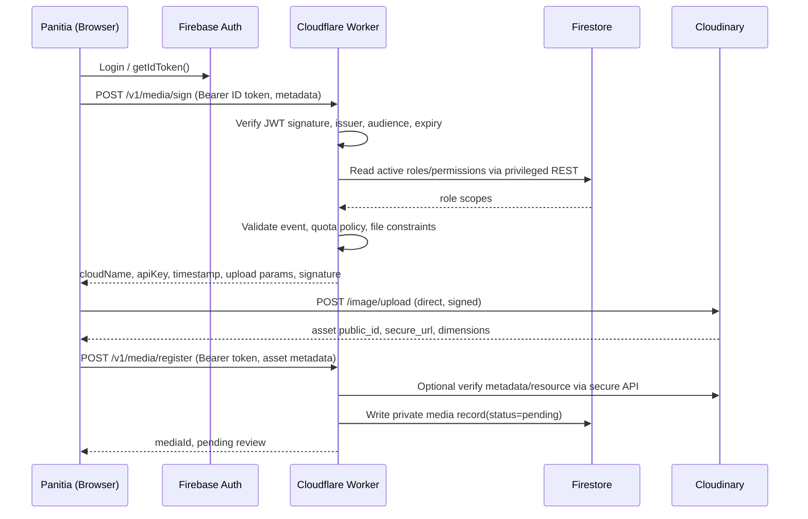

# 14 — Cloudinary Free + Cloudflare Workers Free (Media & Privileged API)

## Mengapa eksternal?
Firebase Cloud Storage tidak dapat dipakai dalam Spark sejak 3 Februari 2026. Untuk foto publik yang diotorisasi, gunakan Cloudinary Free; Cloudflare Worker Free mengeluarkan **signed upload parameters** setelah validasi Firebase token + role. Jangan beralih ke unsigned upload terbuka untuk produksi.

## Flow aman unggah foto

## Parameter ke Cloudinary
- Signed params hanya: `folder/asset_folder` jika tersedia pada plan dan tervalidasi, `public_id` random, `timestamp`, `upload_preset` signed yang dikonfigurasi.
- File type: `image/jpeg`, `image/png`, `image/webp` yang valid; ukuran target ≤500 KB, hard cap contoh 2 MB per foto setelah compression; dimensi max 1600–2000 px panjang. Atur batas di dua sisi.
- Set `resource_type=image`, batasi jumlah unggahan per hari per akun/event (misal 20/hari draft) via server usage count; jangan klaim limit ini sebagai kuota provider.
- Return `secure_url` HTTPS dan `public_id`; simpan EXIF-stripped result.
- Image delivery transform aman dengan allowlist `f_auto,q_auto,w_...` atau preset; jangan transform tak terbatas yang memakan kredit.
- **Cloudinary API Secret**, Firebase service account dan Worker environment secret jangan di repository atau response API.

## Worker endpoints priviliged awal
- `POST /v1/media/sign`: contributor/role aktif; per-uid cap; signed params.
- `POST /v1/media/register`: ownership dan asset yang baru diunggah; jangan percaya URL arbitrer.
- `POST /v1/results/:divisionId/approve`: event_admin/super_admin, atomic publication version.
- `POST /v1/results/:divisionId/return`: event_admin, revisi dengan alasan.
- `POST /v1/news/:articleId/publish`: editor assigned; sanitized public copy.
- `POST /v1/roles/assign`: super_admin only, audit trail.
- `GET /api/v1/...`: data publik, cache.

## Authorization pada Worker
- Verifikasi Firebase ID token menggunakan Google public cert/JWKS dan claims standar.
- Gunakan service account dengan izin minimal Firestore via IAM untuk REST; kredensial disimpan sebagai Worker secrets, dicatat rotasi.
- **Firestore IAM requests bypass Rules**; semua query dan write wajib memeriksa role/scope dan memfilter field sendiri.
- Rate-limit dapat dipakai dengan mekanisme sederhana menggunakan dokumen kuota per user/bucket, tetapi perhatikan writes/CPU. Untuk produksi lakukan uji abuse; Cloudflare WAF/rate limit spesifik bisa punya batas plan, jangan asumsikan gratis.
- Cache `GET` publik dengan TTL 30–60 detik; endpoint private `Cache-Control:no-store`.
- Error 401/403/409/413/429; jangan memuat token ke log.

## Worker Free CPU 10ms
Membuat RS256 signature verifications, auth service-account, dan beberapa REST fetch dapat menekan 10ms CPU pada Workers Free. **MVP harus mengukur CPU dengan real traffic**; pemrosesan signature umumnya menggunakan WebCrypto native, hindari library CPU-heavy. Bila fail, sederhanakan server operations/split per transaction yang aman, atau kurangi fitur; tidak boleh diam-diam meng-upgrade.

## Risiko yang harus diakui
- Cloudinary free punya total kredit bandwidth/storage/transform per bulan. Foto yang viral dapat menghabiskan budget lebih cepat.
- Worker 100k requests/day; API key publik bukan alat proteksi terhadap scraping. Gunakan cache dan allowlist dataset.
- Kredensial service account berisiko tinggi; least privilege, secret rotation, endpoint whitelist, monitor.
- Foto yang diupload, meski belum dipublikasikan artikel, bisa diakses jika URL bocor. Jangan upload data privasi.
- Media konten pengguna perlu moderasi manual; bukan otomatis aman hanya karena sudah signed.
